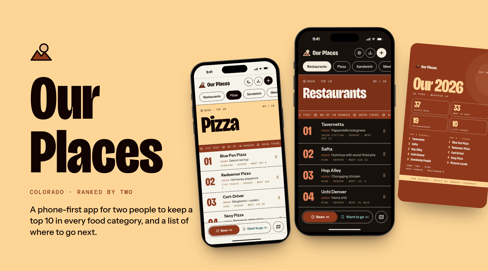
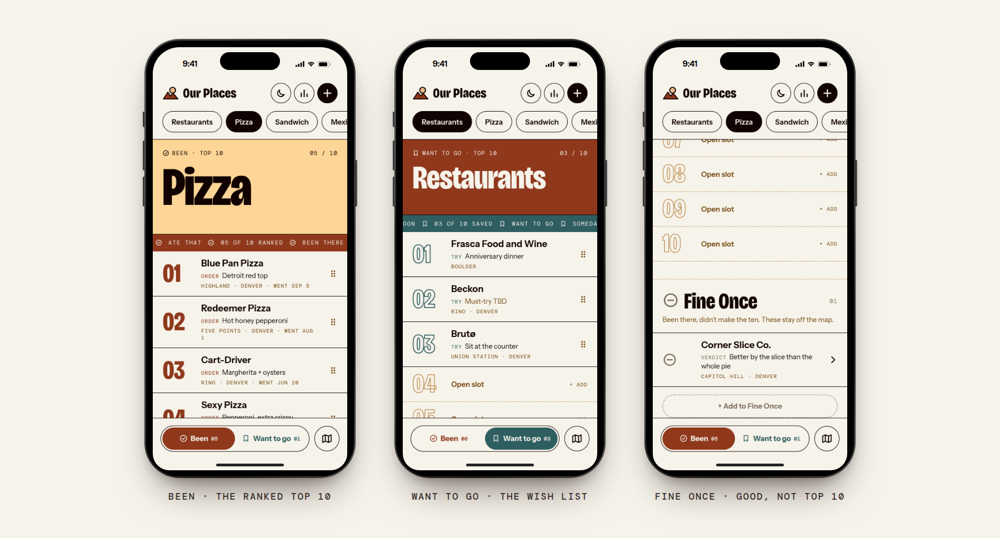
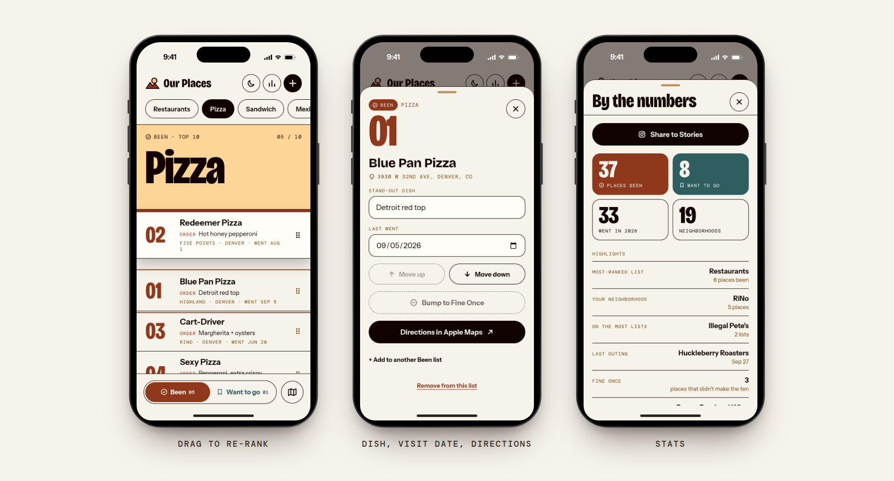
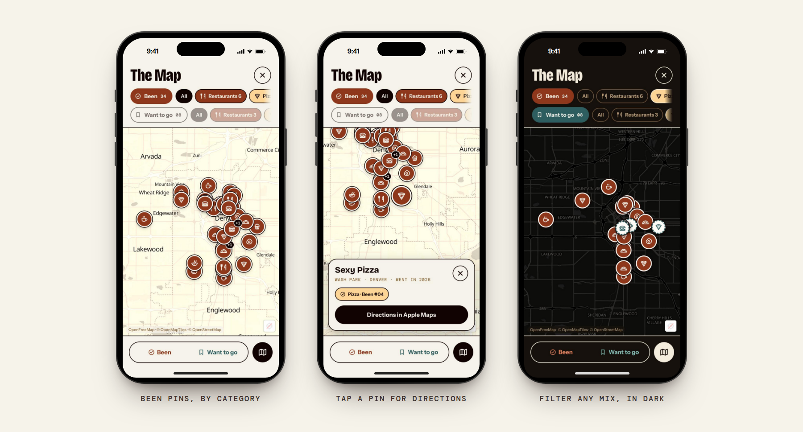
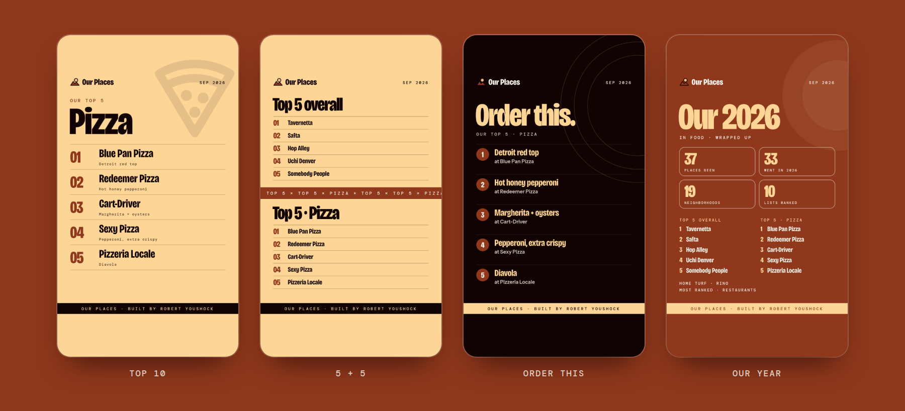
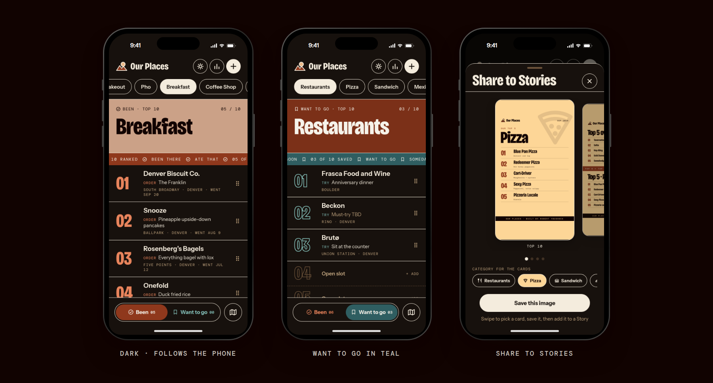
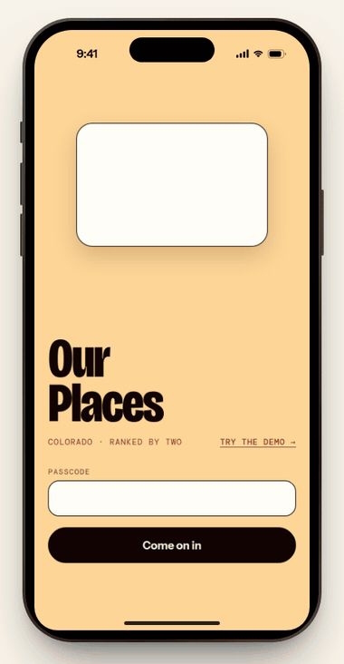
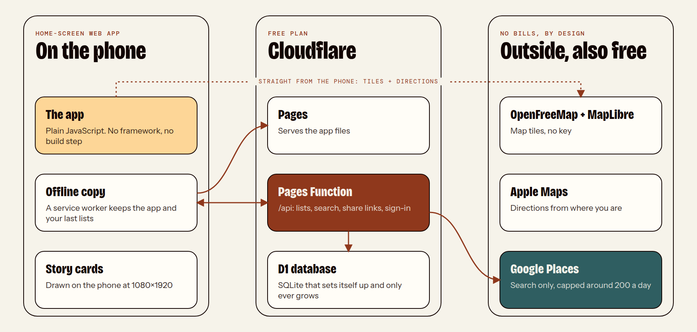

  

# Our Places

**A top 10 for every kind of food, kept by two people.**

Our Places is a small web app for couples, roommates or best friends who eat out together. Every category (Pizza, Pho, Coffee, Happy Hours, anything you add) gets its own **ranked top 10** of places you've been. Next to it sits a **wish list** of places to try. When a Want to go place finally gets a visit, it moves over to Been and takes a rank.

It's made for the phone and installs to the home screen. Both phones stay in sync on their own. It still opens with no signal, and it costs nothing to run.

`Vanilla JS` · `No build step` · `Cloudflare Pages + D1` · `MapLibre` · `$0 a month`

**[Try the demo →](https://eats.robertyoushock.com/?demo)** It's the real app, read-only, filled with sample Denver spots. The source code is private; this repo is the project page.

---

## Two lists, two looks

It should never be unclear which list you're looking at, so each one looks different:

- **Been** is rust, with a check mark. It's a real ranking, 01 to 10, in big condensed numbers.
- **Want to go** is teal, with a bookmark. It's a wish list, drawn with outlined numbers.
- **Fine Once** is stone gray, with a flat line. It holds places you've been that were fine but didn't make the ten. It isn't ranked, it doesn't show on the map, and it stays private when you share.

Color is never the only clue. The icon and the label change with it too, so the lists stay easy to tell apart for colorblind eyes and in dark mode.

## Rank it your way

- **Drag to re-rank** by the grip on any row. The other rows slide out of the way, and the list scrolls when you reach an edge.
- **Save the dish to order** at each place, so the list doubles as a menu guide.
- **Visit dates** can be a full date or just a year ("Went in 2026"), for places you can't pin down.
- **Directions** open Apple Maps from wherever you are.
- **Stats:** places been, visits this year, neighborhoods, your home turf, and the lists each place shows up on.

## Every spot, one map

- Every place gets a pin with its category's icon. A rust coin means Been; a dashed teal ring means Want to go.
- You can turn either list off, or pick categories one by one, like "only coffee and bakeries we've been to."
- Tap a pin to see the place, its rank, and a Directions button.
- The map runs on open-source MapLibre with free OpenFreeMap tiles, so there's no key, no account and no bill.

## Share to Stories

Four story cards inspired by Spotify Wrapped, drawn right on the phone at Instagram's 1080×1920 size:

1. **Top 10** in a category.
2. **5 + 5:** your top 5 overall and your top 5 in one category.
3. **Order this:** the top 5 with the dish to get at each.
4. **Our year:** the summary.

Swipe through them, pick a category, then share one or all four through the phone's share sheet. The layout stays clear of the areas Instagram covers. The cards never show the wish list, Fine Once names, or the app's address.

## Light, dark, and a sign-in that explains itself

<table>
<tr>
<td width="42%"></td>
<td>

The app follows the phone's light or dark setting, and a button in the header switches it by hand. Both themes come from one set of color tokens, and each one was checked on its own.

Before you sign in, the sign-in screen plays a 12-second loop of what the app does: **Rank it · Try it · Map it · Fine once.** It uses placeholder shapes only, never real places, and it holds still for anyone who has reduced motion turned on.

**Just curious?** The sign-in screen has a **[Try the demo](https://eats.robertyoushock.com/?demo)** link. It opens the full app read-only, filled with sample Denver spots, and you can still make story cards from it.

</td>
</tr>
</table>

---

## How it's built

- **About 4,000 lines of plain HTML, CSS and JavaScript.** There's no framework and no bundler; the files in `public/` are what runs. One Pages Function handles the API.
- **Self-setting-up database.** The tables create themselves on the first request. Changes only ever *add* tables and columns, so any older version can run on today's data, and rolling back is one tap.
- **Search from the server.** The Google key never reaches a browser, and daily caps make sure it can't send a bill.
- **Syncing two phones:** each open phone checks for the other's changes every 20 seconds. It pauses while you're dragging, typing, or in the background.
- **Offline:** a service worker keeps the app and your last-loaded lists, and the app says when it's showing a saved copy.
- **Sharing:** a read-only link can be made or turned off at any time. The server leaves Fine Once out of what it sends.
- **Sign-in:** one shared passcode, a signed cookie that lasts a year, and a limit on attempts per hour.

### Staying free

| Piece | Service | Free allowance | Two people use |
| --- | --- | --- | --- |
| Hosting + API | Cloudflare Pages + Functions | 100,000 requests a day | a few hundred |
| Database | Cloudflare D1 | 5 GB, 5 million reads a day | a few MB |
| Place search | Google Places (New) | monthly free tier, capped at about 200 a day | a handful |
| Map | MapLibre + OpenFreeMap | open source, no key | — |
| Story images | the phone's own canvas | — | — |

## Design notes

- **Type:** [Bricolage Grotesque](https://fonts.google.com/specimen/Bricolage+Grotesque) at its narrowest width for the loud parts (ranks, headlines, the wordmark). [Instrument Sans](https://fonts.google.com/specimen/Instrument+Sans) for reading. [DM Mono](https://fonts.google.com/specimen/DM+Mono) for labels and the ticker.
- **Color:** a warm palette built around food.

  | Token | Hex | Used for |
  | --- | --- | --- |
  | Rust | `#8F381C` | Been |
  | Teal | `#2F5E61` | Want to go |
  | Stone | `#7A6C5D` | Fine Once |
  | Butter | `#FDD697` | highlights |
  | Cream / Ink | `#F6F3EA` / `#110301` | page and text |

  Each category also gets its own color.
- **Motion:** list rows rise in, lists slide sideways when you switch between them, and the sign-in plays its loop. All of it is short, and it respects reduced motion.
- **Phone first:** everything is laid out for a phone screen before anything else. Buttons are sized for thumbs, and the list switcher sits at the bottom of the screen.

## Built in versions

Each version is saved as a branch, so any of them can come back in one tap.

| | Added |
| --- | --- |
| v1 | Top 10 and wish list per category, search, map with category pins, dark mode, live sync |
| v2 | Drag to re-rank, visit dates, stats, read-only share link, works with no signal |
| v3 | Fine Once, year-only dates, the sign-in animation |
| v4 | Share to Stories (one card) |
| v5 | Four Wrapped-style story cards with a picker |
| v6 | Try-the-demo mode with sample data, this showcase |

## Credits

Designed and built by **[Robert Youshock](https://github.com/robertyoushock)** in Denver, with Claude (Anthropic) as a coding partner. Say hi on [LinkedIn](https://www.linkedin.com/in/robert-youshock-1ba979108/).

Map data © [OpenStreetMap](https://www.openstreetmap.org/copyright) contributors, tiles by [OpenFreeMap](https://openfreemap.org), rendering by [MapLibre GL JS](https://maplibre.org) (BSD-3). Fonts are from Google Fonts under the SIL Open Font License.

*The screenshots and demo use sample data: real, public Denver-area restaurants with made-up picks and dishes, and made-up names for the Fine Once examples.*

© 2026 Robert Youshock. All rights reserved.
